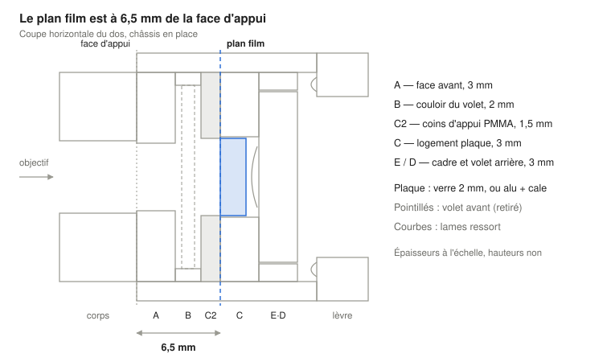
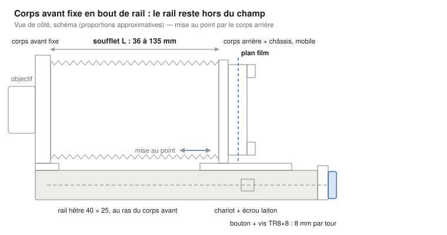

# Micro chambre 6×6 — Dos, porte-dépoli et châssis collodion

Chambre photo en bois pour plaques 6×6 (image 56 × 56 mm), papier et collodion humide sur verre (ambrotype) ou aluminium (ferrotype). Objectifs prévus : Componon 80 f/5.6 et Rodagon-WA 60 f/4 (M39), Mir-26 45 et Zodiak-8 30 (Pentacon Six).

Toutes les cotes sont en millimètres.

## Principe et cotes de référence

Le plan film se trouve **6,5 mm derrière la face d'appui** du corps arrière, pour le porte-dépoli comme pour le châssis. Tout le dos est construit autour de cette seule cote.

- **Face d'appui :** la face arrière de la plaque du corps arrière, dressée bien plane. Le porte-dépoli et le châssis viennent s'y plaquer par l'avant, poussés par des ressorts.
- **Insertion :** les deux cadres ont les mêmes dimensions extérieures (77 × 77 × 12,5 mm). Ils glissent par le haut dans deux glissières en L.
- **Référence du plan film :** dans les deux cadres, c'est la face *avant* de la plaque (ou du dépoli). Elle repose sur un épaulement situé à 6,5 mm de la face avant du cadre. L'épaisseur du support (verre, alu, papier) ne change donc pas le plan.
- **Image :** 56 × 56 mm sur plaque 60 × 60 mm. Les formats réduits sont faits par des caches logés dans le corps arrière (voir plus bas).
- **Liaison avec le corps avant :** pour les objectifs Pentacon Six (tirage 74,1 mm), la face d'appui des planchettes doit être à **74,1 − 6,5 = 67,6 mm** de la face d'appui du dos. Le corps avant est fixe en bout de rail et le corps arrière coulisse, relié par un soufflet : cette distance correspond à un soufflet de 51,6 mm, à recaler avec la valeur de 6,5 mm réellement mesurée.

| Cote | Valeur | Tolérance |
| --- | --- | --- |
| Face d'appui → plan film | 6,5 mm | identique dépoli / châssis à ±0,05 mm |
| Fenêtre image | 56 × 56 mm | — |
| Plaque (verre ou alu) | 60 × 60 mm | −0 / −0,3 mm |
| Logement plaque | 61 × 61 mm | ±0,2 mm |
| Cadres (dépoli, châssis) | 77 × 77 × 12,5 mm | épaisseur ±0,1 mm |

Le contreplaqué « 3 mm » varie souvent de 2,8 à 3,2 mm : mesure tes plaques avant de couper, et débite toutes les couches d'un même cadre dans la même plaque.

La plaque est poussée par l'arrière contre les coins C2. Le châssis entier est poussé contre la face d'appui par les ressorts des glissières : les deux références sont des faces avant, jamais des épaisseurs de support.

## Corps arrière

Le corps arrière est une plaque de bois dur de 90 × 86 × 6 mm, percée d'une fenêtre de 60 × 60 mm. Deux glissières en L sont collées sur ses côtés, et une butée basse retient les cadres.

**Plaque de référence** (bois dur : noyer, hêtre ou érable)

| Élément | Cote |
| --- | --- |
| Plaque, largeur × hauteur × épaisseur | 90 × 86 × 6 mm |
| Fenêtre, centrée en largeur | 60 × 60 mm, de x = 15 à 75 mm |
| Position verticale de la fenêtre (depuis le bas) | de y = 13,5 à 73,5 mm, centre à 43,5 mm |
| Feuillure pour caches, sur la face arrière | 66,4 × 66,4 mm, profondeur 1,0 mm, centrée sur la fenêtre |
| Butée basse (baguette) | 90 × 5 × 14 mm, collée sur la face arrière, en bas |

La face arrière est la face d'appui. Dresse-la sur une glace avec un papier abrasif collé (grain 180 puis 320), jusqu'à ce qu'une règle de précision ne laisse passer aucun jour.

**Glissières en L** (×2, gauche et droite)

| Pièce | Section | Longueur | Rôle |
| --- | --- | --- | --- |
| Entretoise | 6,25 × 14 mm | 81 mm | Fixe la largeur du passage à 77,5 mm |
| Lèvre | 9,25 × 4 mm | 81 mm | Recouvre le cadre de 3 mm à l'arrière |
| Lame ressort, bronze phosphoreux 0,3 mm | 8 × 30 mm | 2 par côté | Plaque le cadre contre la face d'appui |

Le passage entre la face d'appui et les lèvres fait 14 mm : 12,5 mm de cadre et 1,5 mm de course pour les ressorts. Les lames sont cintrées d'environ 2 mm et vissées sous les lèvres (vis M2 noyées), extrémités libres vers le cadre.

**Fixation du soufflet et du chariot**
Le soufflet se visse sur la face avant de la plaque, par son cadre d'extrémité (voir la section Soufflet). La plaque est fixée sur le chariot du rail, avec une cale de 2 mm, pour que sa fenêtre soit à 51,5 mm au-dessus du rail, à la même hauteur que celle du corps avant. C'est tout le corps arrière, châssis compris, qui se déplace pour la mise au point.

**Finition :** noir mat à l'intérieur et dans la fenêtre. La face d'appui reste brute ou reçoit une gomme-laque très fine, poncée à plat.

## Porte-dépoli

Le porte-dépoli est un empilage de cinq couches de 77 × 77 mm, pour 12,5 mm d'épaisseur. La face dépolie du verre repose sur un épaulement à 6,5 mm de la face avant, exactement comme la plaque dans le châssis.

| Couche (avant → arrière) | Matériau | Épaisseur | Ouverture centrée |
| --- | --- | --- | --- |
| A — face avant | contreplaqué aviation | 3 mm | 58 × 58 |
| B — entretoise | contreplaqué aviation | 2 mm | 58 × 58 |
| C2 — épaulement | PMMA | 1,5 mm | 58 × 58 |
| C — logement du verre | contreplaqué aviation | 3 mm | 61 × 61 |
| D — cadre de retenue | contreplaqué aviation | 3 mm | 58 × 58 |

- **Verre dépoli :** 60 × 60 × 2 mm, face dépolie vers l'avant, contre C2. Un dépoli fin (grain 600 ou plus) facilite la mise au point avec les objectifs grand angle.
- **Maintien :** quatre pastilles de liège de 1 mm, collées sous D, appuient sur les coins du verre et rattrapent le millimètre libre du logement.
- **Assemblage :** A, B, C2 et C sont collés (colle époxy pour le PMMA) puis serrés sur une surface plane. D est vissé (4 vis M2) pour pouvoir changer le verre.
- **Repères :** trace au crayon dur 0,3 mm sur la face dépolie, centrés, les contours 56 × 56, 50 × 50, 56 × 28 et 50 × 25, plus une croix centrale fine.
- **Préhension :** une languette de contreplaqué 3 mm de 20 × 10 mm est collée en haut et dépasse de 8 mm.
- **Visée :** une loupe de 4× à 8× posée sur D suffit pour commencer. Un capuchon de visée repliable pourra venir se visser sur D.

## Châssis collodion (verre et alu, sans bac)

Le châssis reprend l'empilage du porte-dépoli, avec un couloir pour le volet et des coins d'appui au lieu d'un épaulement plein. La plaque, émulsion vers l'avant, ne touche le châssis que par ses quatre coins, hors de l'image.

| Couche (avant → arrière) | Matériau | Épaisseur | Ouverture / forme |
| --- | --- | --- | --- |
| A — face avant | contreplaqué aviation | 3 mm | fenêtre 58 × 58 |
| B — couloir du volet | contreplaqué aviation | 2 mm | U ouvert en haut : côtés 3,5 mm, bas 4 mm, passage 70 mm |
| C2 — coins d'appui | PMMA | 1,5 mm | fenêtre 61 × 61 avec 4 coins laissés en triangle (côtés 4 mm) |
| C — logement plaque | contreplaqué aviation | 3 mm | 61 × 61 |
| E — cadre du volet arrière | contreplaqué aviation | 3 mm | 65 × 65 |
| D — volet arrière (logé dans E, affleurant) | contreplaqué aviation | 3 mm | plein, 64,6 × 64,6, amovible |

**Coins d'appui (C2)**
La fenêtre de 61 × 61 mm est découpée dans le PMMA en laissant, dans chaque angle, un triangle rectangle dont les côtés font 4 mm. La plaque de 60 × 60 repose sur ces triangles sur environ 3 mm de côté. Le coin de l'image 56 × 56 reste 0,7 mm au-delà de l'hypoténuse, il n'est donc ni masqué ni touché. Le PMMA ne réagit pas au nitrate d'argent.

**Volet avant**

- Contreplaqué aviation 1,5 mm ou PMMA noir opaque 1,5 mm, 69,5 × 88 mm, avec une poignée de 15 mm en haut.
- Il glisse dans le couloir B et masque la fenêtre de A.
- Piège à lumière à l'entrée du couloir : une bande de velours noir de 70 × 8 mm collée sur A et une autre sur C2, au bord supérieur.

**Volet arrière et pression**

- D se loge dans E, en appui sur le bord de C, et affleure la face arrière : l'épaisseur totale reste 12,5 mm. Il est tenu par deux tourniquets en laiton vissés dans le bord de E (6 mm de large), en haut et en bas, hors de la zone des lèvres des glissières.
- Une lame en bronze phosphoreux de 0,3 mm, de 10 × 50 mm et cintrée d'environ 1 mm, est rivetée au centre de D. Elle pousse la plaque contre les coins.
- **Verre 2 mm :** la lame appuie directement sur le dos du verre.
- **Alu 0,4 mm :** une cale de PMMA de 1,5 mm (59,5 × 59,5 mm) est placée derrière la tôle. L'ensemble fait 1,9 mm, comme le verre à 0,1 mm près, donc la même lame convient. La cale garde aussi la tôle plane.
- **Papier :** même cale de 1,5 mm derrière le papier, émulsion vers l'avant.

**Sans bac de récupération**
Sans bac, le nitrate d'argent qui s'égoutte touche directement le bois. Protège toutes les faces intérieures (C2 excepté) de trois couches de vernis époxy ou de gomme-laque, puis d'un noir mat compatible. Égoutte bien la plaque sur un papier absorbant avant de la charger, coin bas posé sur le papier quelques secondes, et essuie le dos. Rince et sèche le châssis après chaque séance.

## Caches de formats

Les caches se logent dans la feuillure de 1 mm de la face d'appui du corps arrière. Un seul cache sert donc à la fois pour la visée sur le dépoli et pour la prise de vue.

| Format | Ouverture du cache (centrée) |
| --- | --- |
| 6×6 | aucun cache (fenêtre de 58 × 58 des cadres) |
| 5×5 | 50 × 50 mm |
| 6×3 panoramique | 56 × 28 mm (pivoter de 90° pour la vue verticale) |
| 5×2,5 | 50 × 25 mm |

- **Matériau :** alu 0,8 mm peint noir mat, ou PMMA noir opaque 0,8 mm. Format extérieur 66 × 66 mm.
- **Maintien :** ajustement doux dans la feuillure, plus deux petits aimants néodyme Ø 3 mm noyés dans la plaque (et une rondelle acier collée sur les caches en PMMA).
- **Bord de l'image :** le cache est à 6,5 mm du plan film, le bord est donc légèrement adouci. Le flou du bord fait environ 1,2 mm à f/5.6 et 0,6 mm à f/11. Sur collodion, ce bord doux est plutôt esthétique. Si tu préfères un bord net, un cache peut aussi se coller sur la face avant de C2 (à 1,5 mm du plan film) dans un châssis dédié.

## Soufflet, corps avant et rail de mise au point

Le corps avant est fixe, en bout de rail : le rail s'arrête au ras de sa face avant et ne peut donc jamais entrer dans le champ, même avec le Zodiak-8. La mise au point se fait en déplaçant le corps arrière, monté sur un chariot. Un soufflet carré relie les deux corps, avec une longueur L de 36 à 135 mm, et une vis à pas rapide assure la mise au point fine depuis l'arrière.

La mise au point par l'arrière a un autre avantage en proxi-photo : elle ne déplace pas l'objectif, donc ne change pas le cadrage.

**Tirage selon l'objectif**
La distance du plan film à la face avant de la planchette vaut **22,5 + L** : 6,5 mm dans le dos, 6 mm de plaque arrière, L de soufflet et 10 mm de corps avant.

| Objectif | Plan film → planchette | Soufflet L | Mise au point |
| --- | --- | --- | --- |
| Mir-26, Zodiak-8 (Pentacon Six) | 74,1 mm, fixe | 51,6 mm | par la bague de l'objectif, corps arrière bloqué au repère « P6 ∞ » |
| Componon 80, de l'infini à 1:1 | T∞ (à mesurer) → T∞ + 80 | T∞ − 22,5 → T∞ + 57,5 | par le corps arrière |
| Rodagon-WA 60 | T∞ (à mesurer) | planchette en retrait de 15 mm si T∞ < 58,5 mm | par le corps arrière |

Le Componon atteint le 1:1 tant que son T∞ ne dépasse pas 77 mm, ce qui est attendu pour un 80 mm.

**Soufflet**

- Section carrée : 84 × 84 mm à l'extérieur, plis de 8 mm, passage libre de 68 × 68 mm à l'intérieur.
- 24 plis : environ 36 mm comprimé, 135 mm déployé sans tendre les plis à plat.
- Construction : raidisseurs en carton noir de 0,5 mm et 7 mm de large (82 mm de long pour les plis extérieurs, 66 mm pour les plis intérieurs), espacés de 1 mm, collés entre une toile de reliure noire à l'extérieur et une doublure noire mate fine à l'intérieur. Plis alternés, angles en onglet, selon le patron classique du soufflet carré.
- Extrémités : collées à la colle néoprène sur deux cadres en contreplaqué de 3 mm (90 × 86 mm, ouverture 68 × 68 centrée à 43,5 mm du bord bas). Ces cadres sont vissés sur les corps (4 vis M2), le soufflet reste donc démontable.

**Corps avant**

- Cadre en bois dur de 90 × 92 × 10 mm, ouverture 68 × 68 mm centrée à 45,5 mm de son bord bas. Il est collé et vissé sur une semelle fixe de 6 mm, d'équerre, au ras de l'extrémité avant du rail. Sa fenêtre est ainsi à 51,5 mm au-dessus du rail, comme celle du dos. Rien ne dépasse devant la planchette, à part l'objectif.
- Feuillure de 72,4 × 72,4 × 6 mm sur la face avant pour les planchettes de 72 × 72 × 6 mm, qui affleurent. Elles sont tenues par deux tourniquets en laiton.
- **Planchette M39** (Componon, Rodagon) : trou de Ø 39,5 mm, objectif serré par sa bague de fixation d'agrandisseur à l'arrière.
- **Planchette Pentacon Six** : baïonnette récupérée sur un adaptateur Pentacon Six → M42, vissée et collée. Mesure son épaisseur au-dessus de la planchette et décale le repère « P6 ∞ » d'autant.
- **Planchette en retrait** (si besoin pour le Rodagon) : cuvette de 15 mm de profondeur, intérieur noir mat.

**Rail et chariot**

- Rail en hêtre de 40 × 25 × 220 mm, dessus dressé, avec une rainure de 12 × 14 mm au centre du dessus pour la vis. Son extrémité avant affleure la face avant du corps avant ; peins-la en noir mat.
- Chariot du corps arrière : sabot en U (dessus de 60 × 56 × 6 mm, deux joues de 60 × 31 × 6 mm) qui enserre le rail avec un jeu glissant. Des bandes de PTFE adhésif sur les faces de contact rendent le glissement régulier. La plaque de référence y est fixée, d'équerre, sur une cale de 2 mm.
- Blocage : bouton moleté M5 sur une joue, avec un patin en laiton contre le rail.
- Mise au point fine : vis trapézoïdale TR8×8 en inox de 230 mm (8 mm par tour), dans la rainure. Un écrou laiton à collerette est fixé sous le chariot. À l'arrière, la vis tourne dans un roulement 608ZZ logé dans un bloc en bout de rail, avec un bouton de Ø 40 mm. Un degré de rotation déplace le corps arrière d'environ 0,02 mm.
- Repères : réglette graduée en mm collée sur le flanc du rail, index sur le chariot. Repères « P6 ∞ », « Componon ∞ » et « Rodagon ∞ » tracés après réglage sur le dépoli.
- Fixation sur pied : écrou à griffe 1/4" sous le rail, vers le milieu. Comme la masse est surtout à l'arrière, ajoute un second écrou à 40 mm derrière le premier pour équilibrer selon l'objectif.

**Débit complémentaire**

| Pièce | Matériau | Dimensions (mm) | Qté |
| --- | --- | --- | --- |
| Rail | hêtre | 220 × 40 × 25 | 1 |
| Semelle du corps avant (fixe) | bois dur | 90 × 40 × 6 | 1 |
| Cale du corps arrière | bois dur | 90 × 40 × 2 | 1 |
| Corps avant | bois dur | 90 × 92 × 10 | 1 |
| Planchettes | bois dur ou contreplaqué | 72 × 72 × 6 | 2–3 |
| Chariot, dessus et joues | bois dur | 60 × 56 × 6, 60 × 31 × 6 | 1 + 2 |
| Bloc palier arrière | bois dur | 40 × 30 × 20 | 1 |
| Cadres de soufflet | contreplaqué aviation 3 | 90 × 86 | 2 |
| Soufflet | carton noir 0,5, toile de reliure, doublure noire | voir ci-dessus | 1 |
| Vis TR8×8 + écrou laiton, roulement 608ZZ, bouton Ø 40 | — | 230 de long | 1 |
| Bouton de blocage M5, 2 écrous à griffe 1/4", PTFE adhésif, réglette | — | — | 1 |

## Liste de débit et quincaillerie

Cette liste correspond à un corps arrière, un porte-dépoli et un châssis. Pour chaque châssis supplémentaire, ajoute les lignes marquées « par châssis ».

| Pièce | Matériau | Dimensions (mm) | Qté |
| --- | --- | --- | --- |
| Plaque de référence | bois dur | 90 × 86 × 6 | 1 |
| Butée basse | bois dur | 90 × 5 × 14 | 1 |
| Entretoises de glissière | bois dur | 81 × 6,25 × 14 | 2 |
| Lèvres de glissière | bois dur | 81 × 9,25 × 4 | 2 |
| Porte-dépoli A, C, D | contreplaqué aviation 3 | 77 × 77 | 3 |
| Porte-dépoli B | contreplaqué aviation 2 | 77 × 77 | 1 |
| Porte-dépoli C2 | PMMA 1,5 | 77 × 77 | 1 |
| Verre dépoli | verre 2, dépoli fin | 60 × 60 | 1 |
| Châssis A, C, E (par châssis) | contreplaqué aviation 3 | 77 × 77 | 3 |
| Châssis D, volet arrière (par châssis) | contreplaqué aviation 3 | 64,6 × 64,6 | 1 |
| Châssis B, couloir en U (par châssis) | contreplaqué aviation 2 | 2 × (77 × 3,5) + 70 × 4 | 3 |
| Châssis C2, coins (par châssis) | PMMA 1,5 | 77 × 77 | 1 |
| Volet avant (par châssis) | contreplaqué aviation 1,5 ou PMMA noir | 69,5 × 88 | 1 |
| Cale alu / papier | PMMA 1,5 | 59,5 × 59,5 | 1–2 |
| Caches | alu ou PMMA noir 0,8 | 66 × 66 | 3 |
| Languettes de préhension | contreplaqué 3 | 20 × 10 | 2 |

**Quincaillerie et consommables**

- Bronze phosphoreux 0,3 mm : 4 lames de 8 × 30 pour les glissières, et une lame de 10 × 50 par châssis.
- Vis M2 × 6 à tête fraisée, environ 20 ; 2 tourniquets laiton par châssis ; rivets ou vis M2 pour la lame du volet.
- Liège 1 mm (4 pastilles), velours noir adhésif (bandes de 8 mm), 2 aimants néodyme Ø 3 × 1 mm.
- Colle époxy (PMMA et bois), colle à bois, vernis époxy ou gomme-laque, peinture noir mat.

## Calage du plan film et vérifications

Ce qui compte, c'est que le dépoli et la plaque soient dans le même plan, à ±0,05 mm. La valeur exacte de 6,5 mm, elle, sera reportée sur le corps avant.

1. **Mesurer le porte-dépoli :** avec la jauge de profondeur d'un pied à coulisse, mesure la distance entre la face avant et la face dépolie du verre, en quatre points près des coins. Note la moyenne, d_D.
2. **Mesurer le châssis :** charge une plaque de verre propre de 2 mm, puis mesure de la même façon la distance entre la face avant et la face de la plaque, à travers la fenêtre (volet retiré). Note la moyenne, d_C.
3. **Corriger l'écart :** si d_C et d_D diffèrent de plus de 0,05 mm, ponce C2 sur une glace (côté appui) dans le cadre le plus profond, ou ajoute un ruban adhésif de 0,05 mm sur l'épaulement du cadre le moins profond.
4. **Contrôler l'alu :** recommence la mesure du châssis avec une tôle d'alu et sa cale. L'écart avec le verre doit rester sous 0,05 mm.
5. **Repérer l'infini Pentacon Six :** pour les objectifs Pentacon Six, place le corps arrière à L = 74,1 − 16 − d_D (soit 51,6 mm avec d_D = 6,5) et trace le repère « P6 ∞ » sur la réglette.
6. **Vérifier l'étanchéité :** dans le noir, une lampe torche dans le corps arrière, châssis en place et volet fermé, rien ne doit filtrer. Repère les fuites éventuelles au bord du couloir du volet et sur les côtés des glissières.
7. **Test de mise au point :** fais la mise au point sur le dépoli, à pleine ouverture, sur une règle inclinée à 45°. Expose une plaque (ou du papier). La zone nette sur la plaque doit coïncider avec celle vue sur le dépoli.

Pour le Componon et le Rodagon, fais la mise au point à l'infini sur le dépoli avec la vis du chariot, puis trace leurs repères « ∞ ». Mesure ensuite T∞ (plan film → planchette) : il confirme si le Componon atteint bien le 1:1 et si le Rodagon a besoin de la planchette en retrait.
